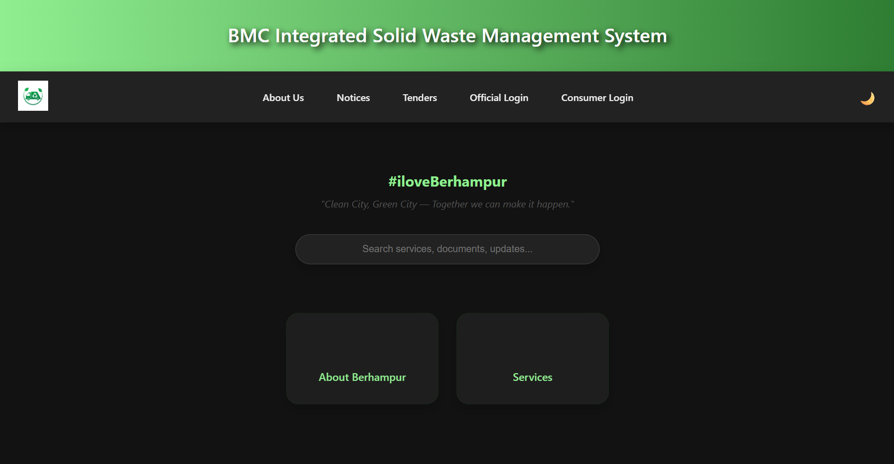
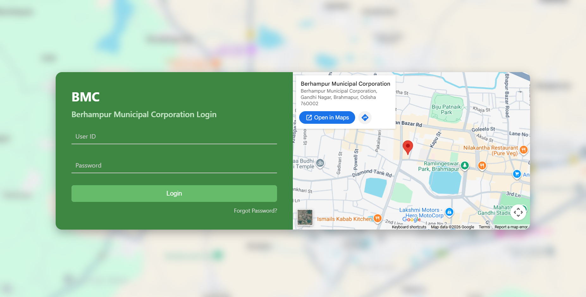
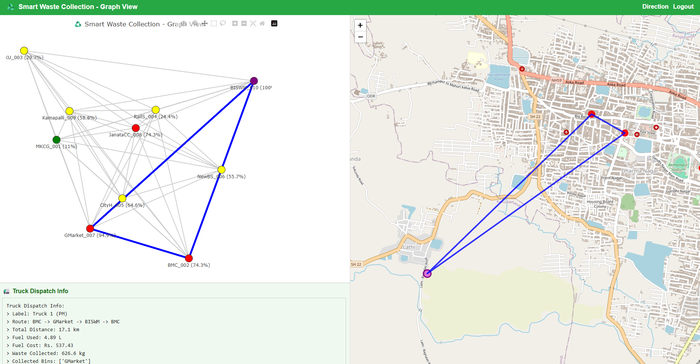
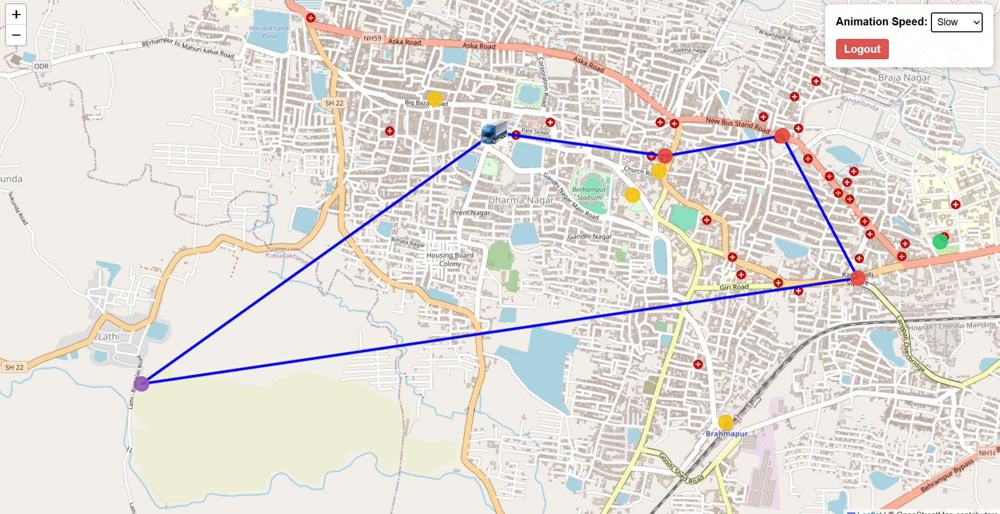

# Smart Waste Collection & Dynamic Route Optimization System

An intelligent solid waste collection simulation and route optimization platform built for the **Berhampur Municipal Corporation (BMC)**. The system models real-time waste accumulation across 10 key urban zones, predicts bin overflows, and dynamically computes optimal collection routes using **Floyd-Warshall**, **Dijkstra**, and **OpenStreetMap (OSMnx)** road network graphs.

---

## Table of Contents
- [Overview](#overview)
- [Key Features](#key-features)
- [Technology Stack](#technology-stack)
- [System Architecture & Workflow](#system-architecture--workflow)
- [Folder Structure](#folder-structure)
- [Prerequisites](#prerequisites)
- [Installation & Local Setup](#installation--local-setup)
- [Running with Docker](#running-with-docker)
- [Usage & Demo Credentials](#usage--demo-credentials)
- [API Endpoints](#api-endpoints)
- [Testing](#testing)
- [Future Improvements](#future-improvements)
- [Contributing](#contributing)
- [License](#license)

---

## Project Screenshots

### 1. Homepage


### 2. Login Page


### 3. Smart Waste Collection Dashboard


### 4. Live Truck Tracking


---

## Overview

Traditional municipal waste collection relies on static schedules, resulting in overflowing bins in high-density zones (such as hospitals and railway stations) and wasted fuel on half-empty routes. This platform simulates an IoT-enabled fleet management dashboard that:
1. Tracks bin fill levels across 10 strategic nodes in Berhampur, Odisha.
2. Prioritizes critical civic zones (`>= 70%` capacity) and predicts imminent overflows (`>= 100%` projected next-cycle level).
3. Computes shortest paths across both an abstract weighted city graph and real drivable OpenStreetMap road geometry.
4. Tracks truck capacity (`5,000 kg` limit), fuel consumption, and operational cost per AM/PM shift.

---

## Key Features

- **Priority & Predictive Dispatch Engine:** Combines strict priority queuing for critical zones (Railway Station, MKCG Hospital, New Bus Stand, City Hospital) with stochastic next-cycle overflow prediction for secondary zones.
- **Opportunistic En-Route Pickup:** Automatically collects non-target bins along a dispatched route if they exceed `70%` capacity and truck payload allows.
- **Dual Visualization Dashboard:**
  - **Network Topology View (Plotly.js):** Real-time interactive node-edge graph highlighting active dispatch paths and bin saturation colors.
  - **Geospatial Road Map (Leaflet.js + OSMnx):** Maps abstract routes onto real street networks using OpenStreetMap road nodes.
- **Live Fleet Telemetry Simulation:** Animated truck tracking view with adjustable playback speeds (`Slow`, `Normal`, `Fast`).
- **Role-Based Access Control (RBAC):** Separate portals for Municipal Administrators (`admin`) and Citizens/Drivers (`user`).
- **Automated Reporting:** Exports cycle telemetry to CSV and generates 10-cycle summary PDF reports every 60 simulation cycles.

---

## Technology Stack

- **Backend:** Python 3.10, Flask, Werkzeug Security
- **Graph & Geospatial Engine:** NetworkX (Floyd-Warshall & Dijkstra), OSMnx, OpenStreetMap
- **Data Processing & Reporting:** Pandas, NumPy, FPDF
- **Frontend:** HTML5, CSS3, Vanilla JavaScript, Plotly.js, Leaflet.js
- **Containerization & CI:** Docker, Gunicorn, Pytest, GitHub Actions

---

## System Architecture & Workflow

```text
[Cycle Tick (5s)]
       │
       ▼
┌──────────────────────────────┐
│ Stochastic Waste Simulation  │ ──► Updates fill levels & predicts next-cycle overflow
└──────────────┬───────────────┘
               │
               ▼
┌──────────────────────────────┐
│ Target Selection & Routing   │ ──► Priority Zones (>=70%) + Predicted Overflows (>=100%)
│ (Floyd-Warshall + Greedy)    │ ──► Route: BMC Depot ➔ Target Bins ➔ BISWM Plant ➔ BMC
└──────────────┬───────────────┘
               │
       ┌───────┴───────┐
       ▼               ▼
┌─────────────┐ ┌──────────────┐
│ /graph-data │ │  /map-data   │ ──► Snaps route hops to real OSM road coordinates
│ (Plotly UI) │ │ (Leaflet UI) │
└─────────────┘ └──────────────┘